<a href="https://gallowforge.github.io/holdfast/#gh-dark-mode-only"><picture><source media="(max-width: 767px)" srcset="docs/readme/hero-dark-phone.webp 3x"><source srcset="docs/readme/hero-dark.webp 2x">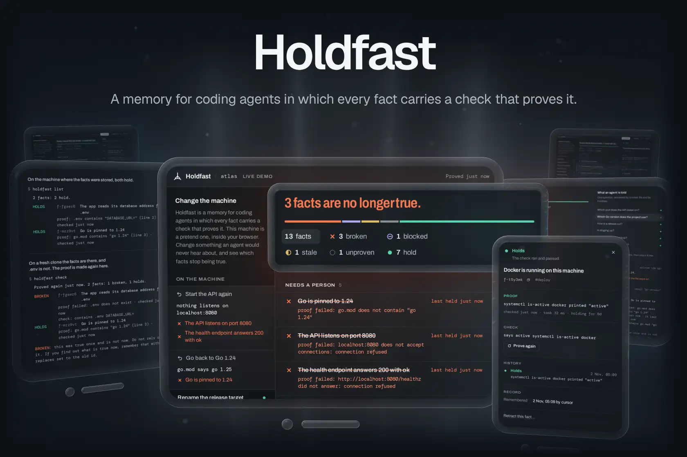</picture></a><a href="https://gallowforge.github.io/holdfast/#gh-light-mode-only"><picture><source media="(max-width: 767px)" srcset="docs/readme/hero-light-phone.webp 3x"><source srcset="docs/readme/hero-light.webp 2x">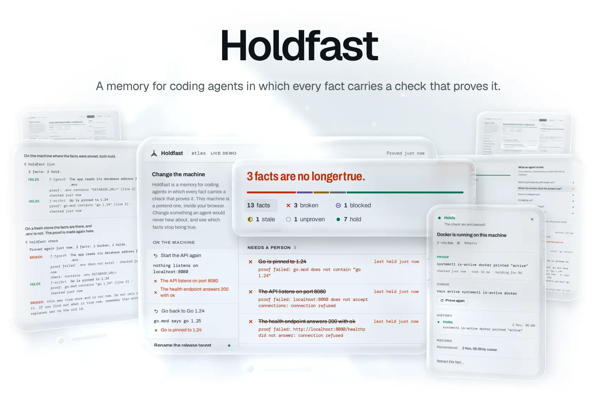</picture></a>

A coding agent keeps notes between sessions: the port the API listens on, the Go version, how a release is cut. Each note is right on the day it is written. Then someone upgrades Go, renames the release target or moves the database, nothing tells the notes, and the next session acts on something that stopped being true weeks ago. **Holdfast is a memory in which every fact carries a check that proves it, and the check runs again before the agent is given the fact.** What still holds comes back with its evidence. What has stopped being true comes back marked BROKEN, with what the check found instead. It is one static binary with no dependencies: a command line for you, an MCP server for the agent, and a ledger to read in a browser.

<p align="center"><a href="https://gallowforge.github.io/holdfast/"><b>Live demo</b></a> &nbsp;·&nbsp; <a href="#quickstart"><b>Quickstart</b></a> &nbsp;·&nbsp; <a href="#how-it-works">How it works</a> &nbsp;·&nbsp; <a href="docs/checks.md">Checks</a> &nbsp;·&nbsp; <a href="docs/agents.md">Agents</a> &nbsp;·&nbsp; <a href="https://github.com/gallowforge/holdfast/releases">Releases</a></p>

<a href="docs/checks.md#gh-dark-mode-only"><picture><source media="(max-width: 767px)" srcset="docs/readme/numbers-dark-phone.webp 3x"><source srcset="docs/readme/numbers-dark.webp 2x">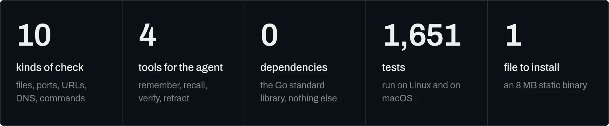</picture></a><a href="docs/checks.md#gh-light-mode-only"><picture><source media="(max-width: 767px)" srcset="docs/readme/numbers-light-phone.webp 3x"><source srcset="docs/readme/numbers-light.webp 2x">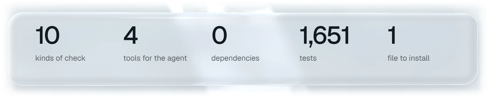</picture></a>

<sub>The tests are the Go test cases, run with the race detector on Linux and once more on macOS, plus the page's own. The binary is the stripped linux/amd64 build on the releases page, with the ledger inside. Every picture here is the real page of <code>holdfast serve --demo</code> or the real output of the binary, taken by <code>make shots</code>.</sub>

## It notices when a fact stops being true

A notes file goes on saying "Go is pinned to 1.24" for as long as nobody edits it. In Holdfast the same sentence is stored with the check `contains go.mod "go 1.24"`, and when the agent asks about the Go version, that check runs first. A check that reads a file runs on every recall; an answer from the network or from a command is reused for up to 30 seconds. So HOLDS means proved moments ago, and BROKEN arrives with what was found instead, when the fact last held, and a plain instruction not to rely on it. The [live demo](https://gallowforge.github.io/holdfast/) puts the two side by side: change the pretend machine, ask the question, and compare what a notes file answers with what Holdfast answers.

<a href="https://gallowforge.github.io/holdfast/#gh-dark-mode-only"><picture><source media="(max-width: 767px)" srcset="docs/readme/recall-dark-phone.webp 3x"><source srcset="docs/readme/recall-dark.webp 2x">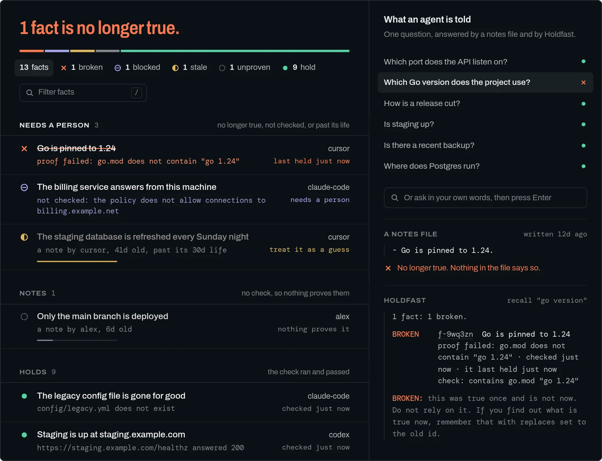</picture></a><a href="https://gallowforge.github.io/holdfast/#gh-light-mode-only"><picture><source media="(max-width: 767px)" srcset="docs/readme/recall-light-phone.webp 3x"><source srcset="docs/readme/recall-light.webp 2x">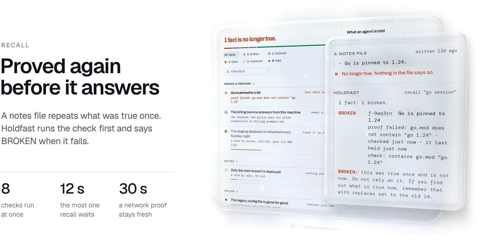</picture></a>

## A wrong fact cannot be stored

A fact has to be true at the moment it is stored. `holdfast add` and the agent's `remember` tool run the check first, and if it fails the fact is refused with the reason, so an agent cannot write a guess into memory as if it were proved. To record that something is not so, start the check with `not`. A fact that cannot be tested is kept as a note instead: it is marked UNPROVEN, it carries its author, and after 30 days it turns STALE unless a person vouches for it again. A note never reads as proof.

<a href="docs/checks.md#gh-dark-mode-only"><picture><source media="(max-width: 767px)" srcset="docs/readme/refused-dark-phone.webp 3x"><source srcset="docs/readme/refused-dark.webp 2x">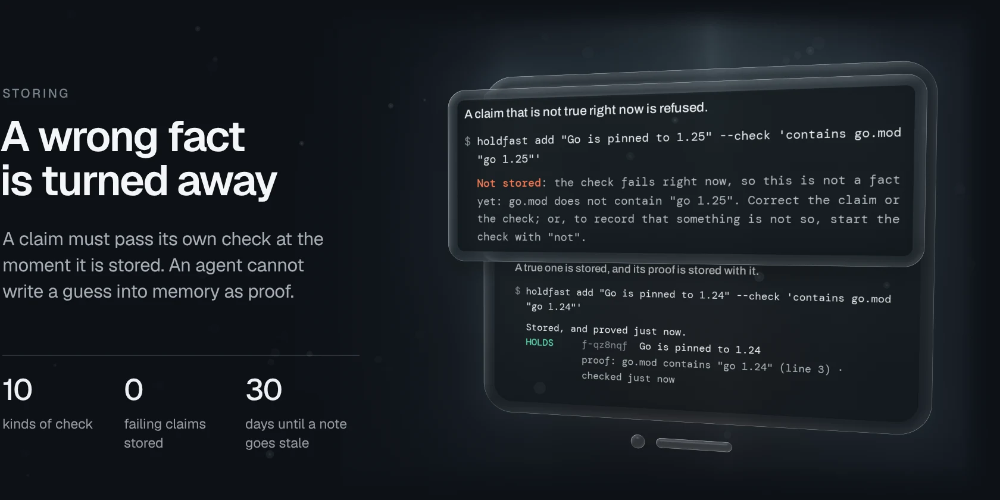</picture></a><a href="docs/checks.md#gh-light-mode-only"><picture><source media="(max-width: 767px)" srcset="docs/readme/refused-light-phone.webp 3x"><source srcset="docs/readme/refused-light.webp 2x">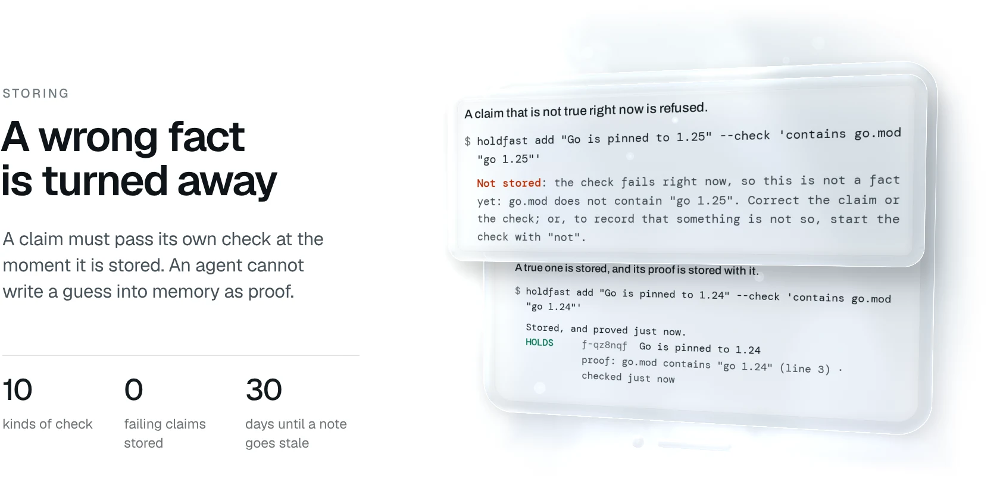</picture></a>

## Every fact carries its proof

Open a fact in the ledger and it answers the question you would ask a colleague: how do you know? It shows the evidence from the last check (the line in the file, the status that came back, the address that answered), the check itself, every time it held or broke, and who stored it. `holdfast why <id>` prints the same in a terminal, and `holdfast export` writes the whole memory as Markdown. Evidence says where the proof was found, never the content of a file or the body of a response.

<a href="docs/how-it-works.md#gh-dark-mode-only"><picture><source media="(max-width: 767px)" srcset="docs/readme/proof-dark-phone.webp 3x"><source srcset="docs/readme/proof-dark.webp 2x">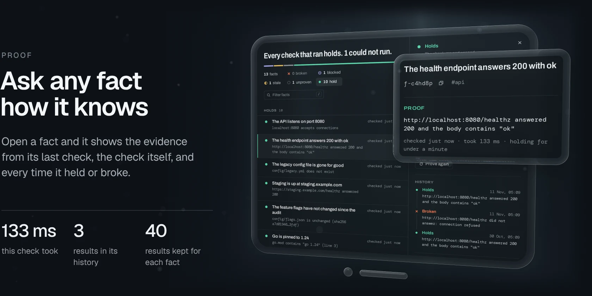</picture></a><a href="docs/how-it-works.md#gh-light-mode-only"><picture><source media="(max-width: 767px)" srcset="docs/readme/proof-light-phone.webp 3x"><source srcset="docs/readme/proof-light.webp 2x">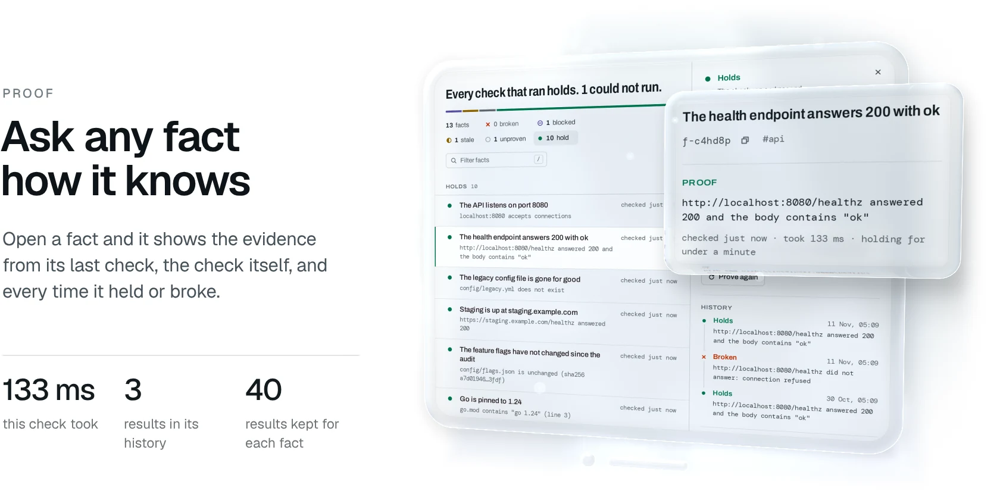</picture></a>

## Checks stay inside what you allowed

A memory that runs checks must not become a way to read your disk or probe your network. A policy file says what checks may touch, and it starts narrow: files inside the project folder, and network addresses on this machine. Only a person widens it, with `holdfast allow` or by editing the file; none of the agent's four tools can. A check outside the policy is not run, and its fact shows as BLOCKED together with the line a person would type to allow it. Commands are off until you allow them one by one, and they run without a shell. A policy that grants more than the defaults and arrives inside a cloned repository does nothing until you approve it on your own machine with `holdfast trust`. The rules are in [docs/policy.md](docs/policy.md), and what they do and do not protect is in [SECURITY.md](SECURITY.md).

<a href="docs/policy.md#gh-dark-mode-only"><picture><source media="(max-width: 767px)" srcset="docs/readme/policy-dark-phone.webp 3x"><source srcset="docs/readme/policy-dark.webp 2x">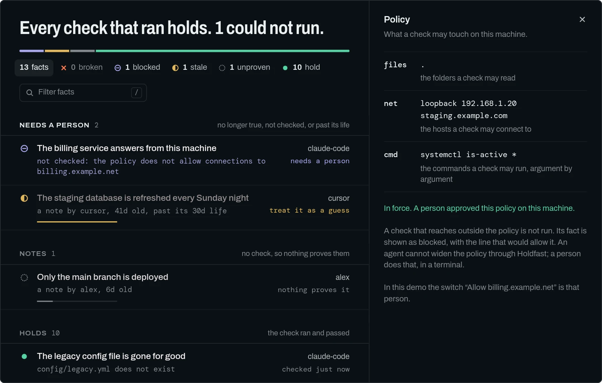</picture></a><a href="docs/policy.md#gh-light-mode-only"><picture><source media="(max-width: 767px)" srcset="docs/readme/policy-light-phone.webp 3x"><source srcset="docs/readme/policy-light.webp 2x">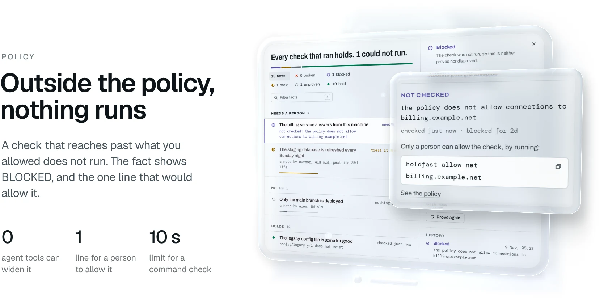</picture></a>

## Shared facts, local proof

The facts live in `.holdfast/facts.jsonl`, a plain file meant to be committed, so a team and every agent it uses share what is known about the project; two branches that each add facts merge without conflicts. The proof lives beside it in `evidence.jsonl`, which stays out of git, because proof is about one machine at one moment. On a fresh clone every fact arrives unchecked and is proved again there: the Go version still holds, and the `.env` file that was never committed is found missing.

<a href="docs/how-it-works.md#gh-dark-mode-only"><picture><source media="(max-width: 767px)" srcset="docs/readme/shared-dark-phone.webp 3x"><source srcset="docs/readme/shared-dark.webp 2x">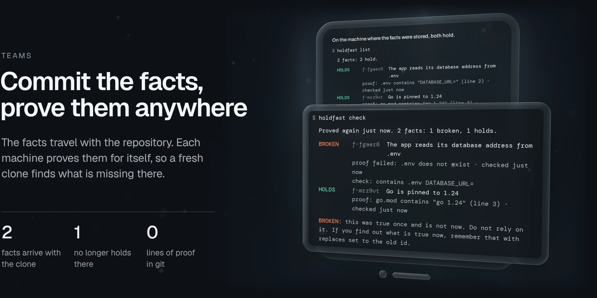</picture></a><a href="docs/how-it-works.md#gh-light-mode-only"><picture><source media="(max-width: 767px)" srcset="docs/readme/shared-light-phone.webp 3x"><source srcset="docs/readme/shared-light.webp 2x">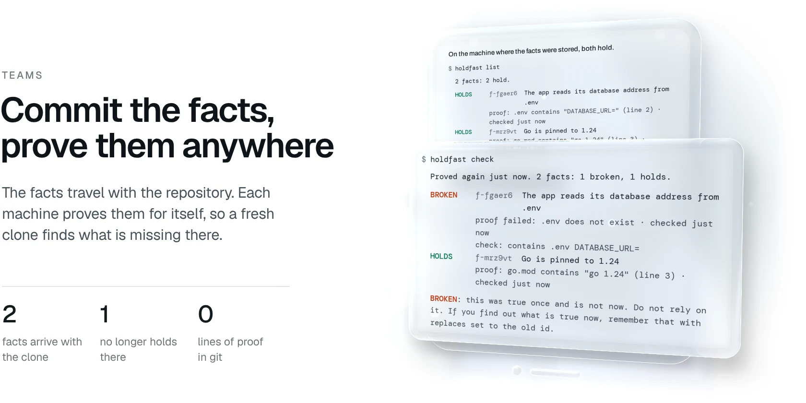</picture></a>

## Why it is different

| | A notes file | A memory that stores text | Holdfast |
| --- | --- | --- | --- |
| What is stored | A sentence | A sentence and its embedding | A claim, the check that proves it, and the evidence from each run |
| When the project changes | Nothing happens | Nothing happens, or a scan someone has to run | The next recall runs the check and says BROKEN |
| Storing something false | Accepted | Accepted | Refused, when the fact has a check |
| What the agent is told | The sentence | The nearest sentences | The status, the evidence, how old the proof is, and what to do about it |
| What it needs | Nothing | Usually a database, a model or a service | One binary, and two files in your repository |

Holdfast is not the only memory that cares about staleness: some scan for drift, and some let an agent mark an entry as verified. The difference here is narrower and stricter. Each fact declares its own test, and that test is the gate both for storing the fact and for getting it back.

## Quickstart

The quickest look is the [live demo](https://gallowforge.github.io/holdfast/): the real ledger in a browser tab, on a pretend project whose machine you can change.

To run it yourself, take the binary for your system from the [releases page](https://github.com/gallowforge/holdfast/releases/latest) (Linux or macOS, amd64 or arm64):

```bash
curl -fsSLo holdfast https://github.com/gallowforge/holdfast/releases/latest/download/holdfast-linux-amd64
chmod +x holdfast && sudo mv holdfast /usr/local/bin/
holdfast serve --demo        # the same demo, served from your machine
```

### The whole idea in a minute

Make a project that pins Go to 1.24:

```bash
mkdir atlas && cd atlas
printf 'module example.com/atlas\n\ngo 1.24\n' > go.mod
holdfast init
```

Store that as a fact, together with the check that proves it:

```console
$ holdfast add "Go is pinned to 1.24" --check 'contains go.mod "go 1.24"'
Stored, and proved just now.
HOLDS     f-eewh8d  Go is pinned to 1.24
          proof: go.mod contains "go 1.24" (line 3) · checked just now
```

Now somebody upgrades Go and tells nobody. The next time anyone asks, the check runs first:

```console
$ printf 'module example.com/atlas\n\ngo 1.25\n' > go.mod
$ holdfast recall "which go version do we use"
1 fact: 1 broken.

BROKEN    f-eewh8d  Go is pinned to 1.24
          proof failed: go.mod does not contain "go 1.24" · checked just now · it last held just now
          check: contains go.mod "go 1.24"

BROKEN: this was true once and is not now. Do not rely on it. If you find out what is true now, remember that with replaces set to the old id.
```

Store what is true now, in place of the old fact:

```console
$ holdfast add "Go is pinned to 1.25" --check 'contains go.mod "go 1.25"' --replaces f-eewh8d
Stored, and proved just now.
HOLDS     f-y5ebwq  Go is pinned to 1.25
          proof: go.mod contains "go 1.25" (line 3) · checked just now
$ holdfast list
1 fact: 1 holds.

HOLDS     f-y5ebwq  Go is pinned to 1.25
          proof: go.mod contains "go 1.25" (line 3) · checked just now
```

### Give it to your agent

```bash
cd your-project
holdfast init                                # creates .holdfast; commit it
claude mcp add holdfast -- holdfast mcp      # Claude Code
```

Cursor, Codex and any other MCP client are covered in [docs/agents.md](docs/agents.md). The agent gets four tools, `remember`, `recall`, `verify` and `retract`, and a short instruction on when to use each: recall before relying on something it believes about the project, remember with a check whenever the fact can be tested. For an agent without MCP, `holdfast brief` prints a proved summary to hand over when a session starts.

`holdfast check` proves every fact again and exits 1 when one is broken or could not be checked in time, so it also works in CI or a pre-commit hook: the build fails when the repository stops matching what the team wrote down about it. `holdfast serve` opens the ledger for your own project.

### Build from source

```bash
git clone https://github.com/gallowforge/holdfast.git && cd holdfast
make            # builds the page (Node 22+), then bin/holdfast with the page inside
make test       # Go tests with the race detector, the page's typecheck and tests
make pages      # the live demo as a static site, with the engine as WebAssembly
make shots      # this README's pictures, from the running binary
```

`go install github.com/gallowforge/holdfast/cmd/holdfast@latest` also works and needs only Go: it builds the command line and the MCP server without the browser ledger, which the release binaries carry.

## How it works

One binary with three faces over the same small engine. `holdfast mcp` serves the agent over stdio. `holdfast serve` serves the ledger to a browser on this machine. The command line is for you and for scripts. All three read and write the same two files in `.holdfast`, and every check they run goes through the same policy.

| Question | Method |
| --- | --- |
| What is a check? | One line in a small grammar of ten kinds: `file`, `contains`, `matches`, `unchanged`, `fresh`, `http`, `port`, `dns`, `cmd` and `says`, each of which can be turned around with `not`. It is parsed into a structure when the fact is stored and never passed to a shell. [docs/checks.md](docs/checks.md) has every kind with real output. |
| When is a fact proved again? | On every recall: file checks always, network and command checks unless the last answer is less than 30 seconds old. `holdfast check` and the `verify` tool prove everything. Eight checks run at once, a recall gives all of them 12 seconds in total, and a check that did not finish is shown as TIMED OUT, never as HOLDS. |
| How does recall find facts? | The words of the question are matched against each claim, its tags and its check. Problems come first: broken, then blocked, stale, unproven, and what holds. There is no model and no embedding, so the same question always gets the same answer. |
| Where do facts live? | `facts.jsonl` is an append-only journal: adding, retracting, replacing and vouching are each one line, and git merges two branches of it as a union. `evidence.jsonl` holds what each check found on this machine and is ignored by git. `holdfast compact` shrinks it. |
| How are checks confined? | A file is opened inside an allowed folder with Go's `os.Root`, which refuses any path or symbolic link that leads out of it. A network check is judged at the moment of connecting, on the address actually being dialled, so a public name that points at a private address is treated as private. Redirects are judged again, requests are GET only, and a command must match a line a person wrote. |
| How does a cloned policy stay inert? | Approval is the SHA-256 of the policy text together with the folder it is in, kept in your own configuration folder, outside every repository. A repository cannot bring its approval along. A file that allows more than the defaults does nothing until you approve it, and any later change to it needs approving again; a file that allows only the defaults needs no approval. |
| How does the agent connect? | The Model Context Protocol over stdio, in both of its forms: with the `initialize` handshake (revisions 2024-11-05 to 2025-11-25) and without one (2026-07-28). Each answer is text for the model and the same content as structured data. |
| How is the ledger kept private? | It listens on loopback and refuses any other address without `--expose`. Every request must carry a header that a page on another site cannot send, the Origin and Host are checked, and a strict Content-Security-Policy forbids inline script. |
| How does the live demo run without a server? | The engine is compiled to WebAssembly and given a pretend machine (files, ports, hosts, a clock) inside the tab. The page is the one the binary serves; nothing is sent anywhere. |

The longer account is in [docs/how-it-works.md](docs/how-it-works.md).

## Quality

Every push runs [`ci.yml`](.github/workflows/ci.yml), and each step also runs on a workstation with `make test`.

| Check | What it covers |
| --- | --- |
| `go test -race` | 1,614 test cases and 5 fuzz targets: the check grammar and every kind of check, path and network confinement, the policy and its approval, the journal and its locking between processes, recall and its ranking, the time budgets, both forms of the MCP protocol, the web API and its protections, the demo's pretend machine, and the command line |
| The same tests on macOS | File locking and path resolution differ there, so the Go tests run on a macOS runner before a macOS binary is published |
| `vitest` and `tsc` | 37 tests: the page's reading of statuses, ages and evidence, the engine's answers as they arrive, the check grammar it shows (guarded against drifting from the engine's), and its filters |
| [`e2e`](e2e) | 5 scenarios against the binary that ships: a person at the command line, an agent over the pipe with and without a handshake, facts travelling through `git clone` while the proof stays home, and the ledger answering only its own page |
| Review findings | Two independent reviews before the first release. Every issue they found is fixed and held by a regression test, in the `review_test.go` and `audit_test.go` files |
| No demo code in the binary | The page inside the binary is searched for the demo's loader, so what you install carries none of it |
| `gofmt`, `go vet` | Formatting and static checks |
| gitleaks | The full history, on every push |

## FAQ

<details>
<summary><b>Why is it called Holdfast?</b></summary>
<br />
A holdfast is the part of a seaweed that grips the rock. It does not feed the plant; it only keeps it from drifting. That is the whole job here: keeping what an agent believes fastened to what is true. The mark is one.
</details>

<details>
<summary><b>Does it replace CLAUDE.md or AGENTS.md?</b></summary>
<br />
No. Instructions and conventions belong there: how you like commits written, which folder holds what. Holdfast is for facts about the project and the machine that can stop being true without anyone noticing: ports, versions, paths, hosts, how something is built or released.
</details>

<details>
<summary><b>What about a fact that cannot be tested?</b></summary>
<br />
It is stored as a note. A note is marked UNPROVEN, names who wrote it, and turns STALE after 30 days (or the time you give with <code>--ttl</code>) unless a person confirms it with <code>holdfast vouch</code>. The agent is told plainly that nothing proves it. Only a person can vouch; an agent cannot.
</details>

<details>
<summary><b>Can an agent use a check to run anything it likes?</b></summary>
<br />
No. <code>cmd</code> and <code>says</code> run only commands a person has allowed, line by line, without a shell, with a ten-second limit. The honest edge: an agent that already has a shell can do whatever a shell can, including editing the policy. The policy is there so that the memory itself is never the way around your agent's own permissions, and so that a repository you clone cannot bring its own. <a href="SECURITY.md">SECURITY.md</a> spells out both sides.
</details>

<details>
<summary><b>Does it call a model or send anything anywhere?</b></summary>
<br />
No model, no embeddings, no telemetry, no account. The only network traffic is the checks you stored, and by default those may reach nothing beyond your own machine.
</details>

<details>
<summary><b>Which agents does it work with?</b></summary>
<br />
Any client that speaks the Model Context Protocol over stdio. <a href="docs/agents.md">docs/agents.md</a> has the exact setup for Claude Code, Cursor and Codex, and a paragraph to put in CLAUDE.md or AGENTS.md so the agent reaches for it.
</details>

<details>
<summary><b>How does the live demo run without a server?</b></summary>
<br />
The same engine is compiled to WebAssembly (<code>make pages</code>) and runs in your tab against a pretend machine. The switches change that machine the way a colleague would change a real one, without telling anybody, and the facts find out for themselves.
</details>

<details>
<summary><b>Does it run on Windows?</b></summary>
<br />
Not yet. The store locks its files in a way that is specific to Unix, so the binaries are for Linux and macOS.
</details>

## Contributing

Issues and pull requests are welcome, especially a new kind of check, or the setup for an agent that [docs/agents.md](docs/agents.md) does not cover yet. Run `make test` first, and keep demo data obviously fake. The README's pictures come from [`docs/readme/src/shots.mjs`](docs/readme/src/shots.mjs), which drives the real binary; `make shots` takes them again.

## Licence

[MIT](LICENSE). Built by Ali Husain.
